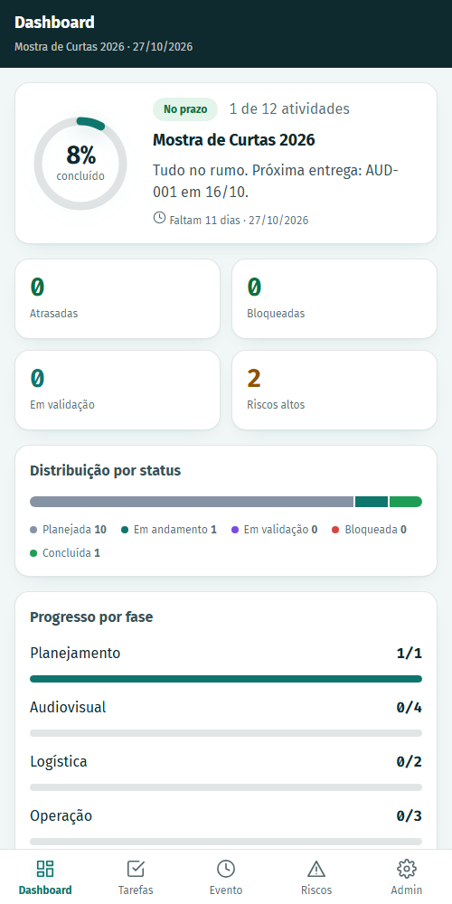
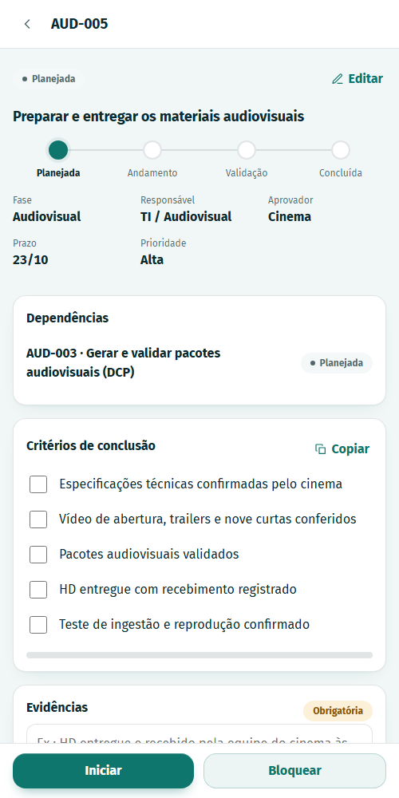
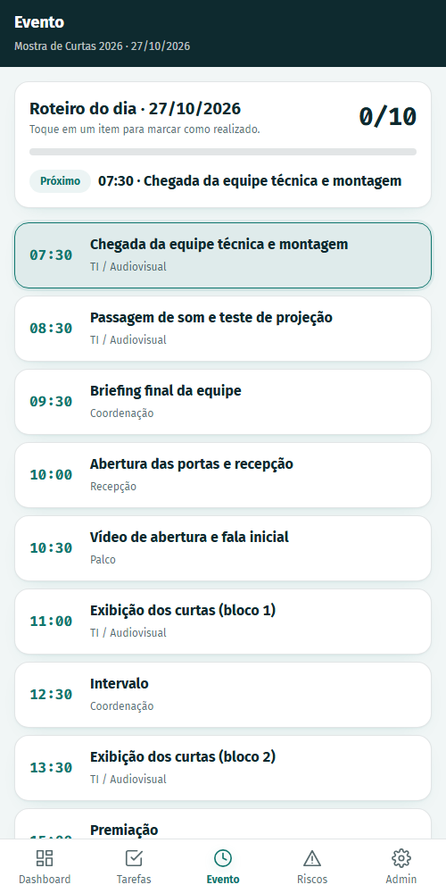
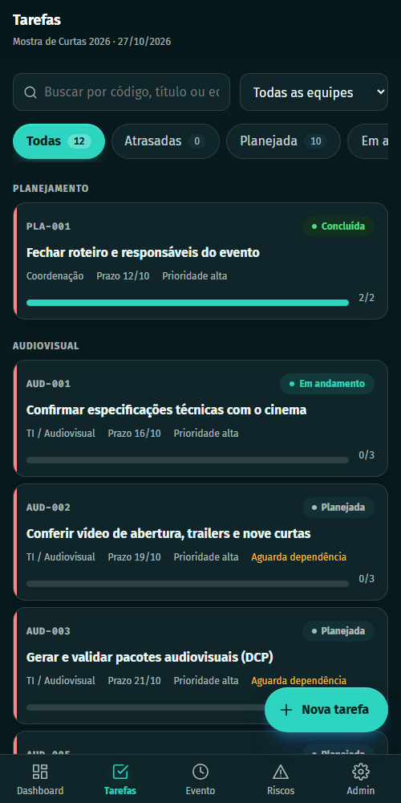
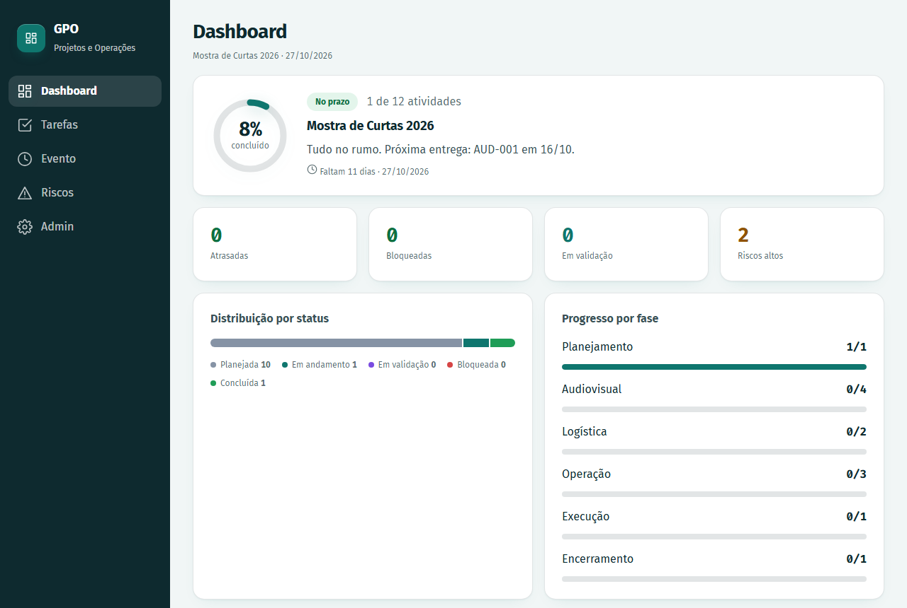

# Gestão de Projetos e Operações (GPO)

Aplicativo Android que funciona **offline** para planejar e executar projetos e eventos escolares. Cada compromisso vira uma tarefa rastreável, com responsável, prazo, dependências, critérios de conclusão e evidências. A coordenação acompanha tudo em um painel de indicadores.

Projeto-piloto: **Mostra de Curtas 2026**. Os dados que vêm no app são fictícios e servem de exemplo.

<p align="center">
  
  
  
</p>
<p align="center">
  
  
</p>

## Funcionalidades

- **Dashboard:**
  - progresso geral e situação do projeto (no prazo, atenção ou crítico);
  - tarefas atrasadas e bloqueadas;
  - distribuição por status, progresso por fase e carga por equipe;
  - exposição a riscos, próximos prazos e atividade recente.
- **Tarefas com fluxo controlado:** o caminho é Planejada → Em andamento → Em validação → Concluída, e a tarefa pode ser marcada como Bloqueada. Ela só é concluída com:
  - todos os critérios atendidos;
  - evidência registrada, quando obrigatória;
  - dependências concluídas.
- **Riscos:** impacto, responsável, plano de resposta e situação.
- **Execução do evento:** roteiro por horário, com o próximo item em destaque.
- **Administração:**
  - projetos: criar, duplicar como modelo e excluir;
  - cadastro de equipes, fases, tarefas, riscos e roteiro;
  - backup e restauração.
- **Offline:** os dados ficam no aparelho e o app não precisa de internet.
- **Acessível:** contraste WCAG AA nos temas claro e escuro, alvos de toque de 44 px e foco visível.

## Tecnologias

React 18 · TypeScript · Vite 5 · Capacitor 6 (Android) · Vitest · ESLint. As fontes Fira Sans e Fira Code (licença SIL OFL) vão embutidas no app.

## Começando

### Pré-requisitos

- [Node.js](https://nodejs.org/) 24 (versão em [`.nvmrc`](.nvmrc))
- Para gerar o APK: JDK 17 e Android SDK com a plataforma 34 (detalhes em [CONTRIBUTING.md](CONTRIBUTING.md))

### Rodar no navegador

```bash
npm ci
npm run dev
```

Abra `http://localhost:5173`. Para ir direto a uma aba, use `#tarefas`, `#evento`, `#riscos` ou `#admin` no fim do endereço. Para abrir uma tarefa, use `#t:<id>`.

### Gerar o APK

```bash
npm run android:apk
```

O arquivo é gerado em `release/gestao-projetos-v<versão>-debug.apk`. Para instalar, copie para o celular e permita a instalação de fontes desconhecidas.

A CI também gera o APK: na aba **Actions → Android APK → Run workflow**, ou automaticamente ao publicar uma versão (veja abaixo).

## Scripts

| Comando | O que faz |
| --- | --- |
| `npm run dev` | Servidor de desenvolvimento |
| `npm run build` | Verificação de tipos e build de produção em `dist/` |
| `npm run typecheck` | Só a verificação de tipos |
| `npm run lint` | ESLint |
| `npm test` | Testes automatizados (Vitest) |
| `npm run check` | Lint, testes e build (o mesmo que a CI roda) |
| `npm run android:sync` | Build e cópia para o projeto Android |
| `npm run android:open` | Abre o projeto no Android Studio |
| `npm run android:apk` | Gera o APK de depuração em `release/` |

## Estrutura

```
.
├── .github/              CI, geração do APK, modelos de issue e PR, Dependabot
├── android/              Projeto Android (Capacitor)
├── docs/                 Projeto da v1.0 e capturas de tela
├── scripts/              Automação (geração do APK)
├── src/
│   ├── components/       Componentes visuais reutilizáveis (ícones, badges, gráficos, modal)
│   ├── data/             Armazenamento local (hoje localStorage; SQLite na v1.0)
│   ├── domain/           Tipos, regras do fluxo e dados de exemplo, com testes
│   ├── features/         Telas por área: dashboard, tasks, risks, event, admin
│   ├── styles/           Sistema visual (tokens, tema claro e escuro)
│   ├── App.tsx           Navegação e composição das telas
│   └── main.tsx          Ponto de entrada
├── CHANGELOG.md          Histórico de versões
└── CONTRIBUTING.md       Como desenvolver, testar e publicar
```

## Dados e privacidade

Os dados ficam apenas no aparelho, no armazenamento local do app; não há servidor nem envio pela internet. Desinstalar o app ou limpar os dados dele apaga tudo. Faça backups regulares em **Admin → Dados → Copiar backup**.

## Versões e publicação

A versão do app fica em um só lugar: o `package.json`. O Android lê dela o `versionName` e o `versionCode`. Ao enviar uma tag `v*` (ex.: `v0.5.0`), a CI gera o APK e cria um **Release** no GitHub com o arquivo anexado. O histórico está em [CHANGELOG.md](CHANGELOG.md).

## Roadmap

O diagnóstico completo e o plano estão em [docs/projeto-v1-offline.md](docs/projeto-v1-offline.md).

| Fase | Entrega |
| --- | --- |
| 0. Estabilização (v0.5) | Botão "voltar" do Android, compatibilidade com aparelhos antigos, bloqueio de dependência circular, backup em arquivo |
| 1. Banco interno (v1.0) | SQLite no aparelho, perfis com PIN, aprovação real, fotos como evidência, auditoria |
| 2. Produtividade (v1.1–1.2) | Notificações, "Minhas tarefas", cronograma visual, matriz de riscos, relatórios |
| 3. Sincronização (v2.0) | Servidor FastAPI + PostgreSQL e vários aparelhos com os mesmos dados |

## Contribuindo

Veja [CONTRIBUTING.md](CONTRIBUTING.md). Para relatar falhas de segurança, siga o [SECURITY.md](SECURITY.md).

## Licença

Ainda não definida. Até a definição, todos os direitos são reservados aos autores.
